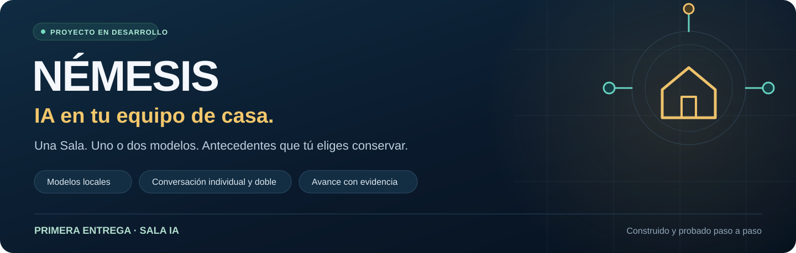
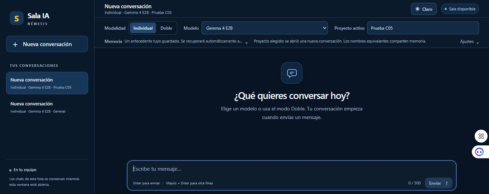
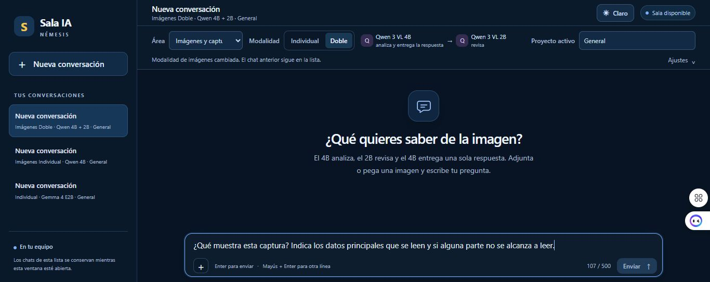
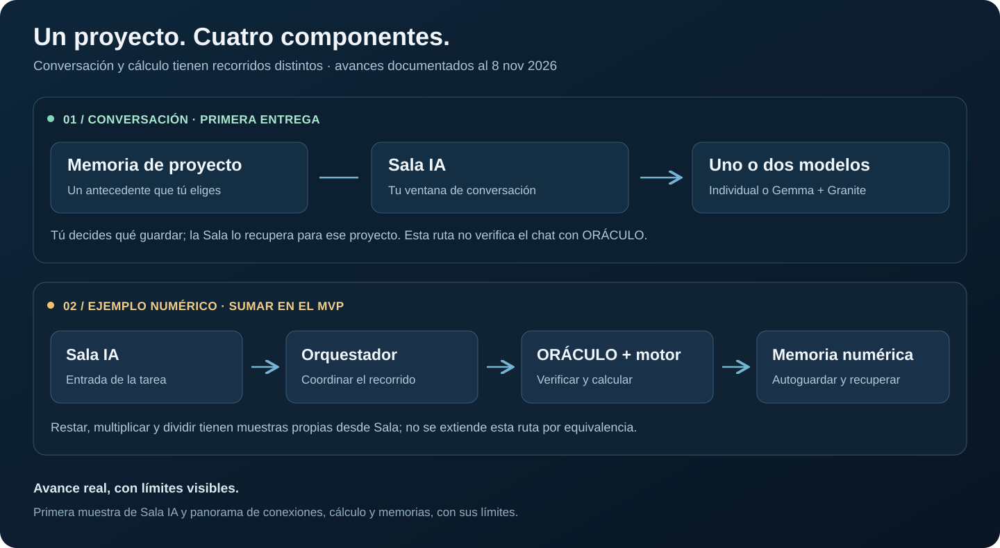

Un proyecto para conversar con modelos ejecutados en el PC y conectar tareas con recorridos de verificación, cálculo y memoria. **Pensado para usuarios de casa, construido paso a paso y todavía en desarrollo.**

Esta muestra presenta **Sala IA** y resume el avance del resto de NÉMESIS. Es documentación de resultados y límites: no contiene el software operativo, pesos de modelos ni un instalador.

[Conocer la Sala](docs/sala-ia.md) · [Modalidades y modelos](#modalidades-y-modelos) · [Ver avances y pendientes](docs/avance-y-pendientes.md) · [Consultar evidencia y alcance](docs/evidencia-y-alcance.md) · [Plan de paquetes para Windows](#plan-de-paquetes-para-windows)

## Una ventana para conversar

*Captura real de Sala R002 con interfaz simplificada. Muestra controles y proyectos genéricos de prueba; no representa una conversación nueva ni una respuesta del modelo.*

| Modalidad | Así funciona |
| --- | --- |
| **Conversación individual** | Eliges un modelo, escribes tu pregunta y recibes su respuesta. Puedes continuar en el mismo chat. |
| **Conversación doble** | Gemma 4 E2B prepara la respuesta, Granite 3.3 8B la revisa y Gemma puede ajustarla. Cuando el recorrido se completa, recibes una sola respuesta. |
| **Memoria del proyecto** | Tú eliges un mensaje tuyo para conservar. La Sala lo recupera automáticamente en otra conversación del mismo proyecto y muestra su origen. |

Los modelos pueden equivocarse. En el ensayo práctico del modo doble se completó el recorrido, pero la respuesta no hizo la comparación solicitada. Ese límite permanece registrado; coordinar dos modelos no garantiza una respuesta correcta.

La memoria del proyecto conserva **un antecedente activo, de hasta 500 caracteres**. Tú eliges qué guardar; no se guarda automáticamente cada mensaje. El recuerdo está en disco y la lista de chats permanece en la memoria de la ventana.

**Tú eliges qué recordar. La Sala lo recupera para tu proyecto.**

## Modalidades y modelos

La configuración local R016 ofrece cinco áreas con modelos propios. Las pruebas se documentan con la versión y el alcance de cada caso.

| Área | Individual | Doble |
| --- | --- | --- |
| **Conversación** | Se elige uno entre Gemma 4 E2B, Granite 3.3 8B, Qwen 3.5 4B y Gemma 3 4B. | Gemma 4 E2B redacta y Granite 3.3 8B revisa. Gemma ajusta la respuesta si la revisión pide cambios. |
| **Programación** | Qwen 2.5 Coder 3B propone código. | Qwen 2.5 Coder 3B propone y CodeGemma 7B revisa. |
| **Imágenes y capturas** | Qwen 3 VL 4B analiza la imagen adjunta. | Qwen 3 VL 4B analiza, Qwen 3 VL 2B revisa y Qwen 3 VL 4B responde. |
| **Documentos** | EmbeddingGemma 300M Q4 busca fragmentos en el corpus piloto. | EmbeddingGemma 300M Q4 y Q8 aportan resultados a la búsqueda. |
| **Razonamiento** | Phi-4 14B analiza el problema. | Phi-4 14B analiza y Phi-4 Mini 3.8B aporta una segunda opinión sobre la ficha inicial. |

*Captura de Sala IA R011 antes de enviar una consulta. Se ven el área Imágenes y capturas, el modo Doble y los roles de Qwen 3 VL 4B y 2B.*

[Ver la ficha de modalidades y sus pruebas](docs/modalidades-y-modelos.md).

## Un proyecto, cuatro componentes

La **Sala** es la puerta de entrada. El **Orquestador** coordina recorridos definidos. **ORÁCULO y el motor** revisan y calculan dentro del alcance aritmético probado. La **memoria** conserva antecedentes o resultados según la ruta.

La conversación libre y el cálculo son rutas distintas. Una respuesta del chat no queda verificada por ORÁCULO por aparecer en la Sala. En el ejemplo numérico23+16=39 se documentaron por separado la aceptación estática, el cálculo y el guardado. [Ver recorridos y memorias](docs/recorridos-y-memoria.md).

## Cómo llega una tarea a ORÁCULO

En el recorrido numérico documentado, la Sala recibe el encargo, el Orquestador coordina a Qwen y Gemma y el adaptador enlaza la propuesta con sus reglas. ORÁCULO la revisa antes de que el motor calcule.

[Seguir el ejemplo de SUMAR 23 + 16 = 39](docs/conexiones-sala-orquestador-oraculo.md). La conversación libre conserva su ruta propia.

## ORÁCULO y el motor de cálculo

La aceptación estática y el cálculo tienen recibos distintos. Un caso real de SUMAR llegó a 39; un control aislado rechazó una resta presentada como suma. Los dos ensayos conservan sus alcances y fechas.

[Ver qué verifica ORÁCULO y qué calcula el motor](docs/oraculo-y-motor-de-calculo.md).

## Memorias conversacional y numérica

En conversación tú eliges qué recordar y la Sala lo recupera para el proyecto. En el recorrido numérico probado se guarda el resultado aceptado y se recupera por identidad del caso. Recordar un resultado no sustituye calcularlo de nuevo.

[Conocer las dos memorias, sus ejemplos y sus límites](docs/memorias-conversacional-y-numerica.md).

## Avances y pendientes

| Área | Avance demostrado | Qué queda por desarrollar o comprobar |
| --- | --- | --- |
| **Sala IA** | Conversación individual, coordinación doble, interfaz y memoria por proyecto. | Historial completo persistente y capacidades nuevas. |
| **Orquestador** | Coordinación del recorrido probado, control de contexto y muestra de repetibilidad. | Más rutas, cargas y concurrencia. |
| **ORÁCULO y motor** | Cuatro operaciones aritméticas en casos concretos supervisados. | Otros programas y dominios requieren comprobaciones propias. |
| **Memorias** | Guardado y recuperación según cada recorrido. | Búsqueda semántica y memoria avanzada. |
| **Equipo doméstico** | Pruebas documentadas y GPU con modelos concretos. | Instalación reproducible en otros equipos y mediciones comparables. |
| **Programación** | Propuesta individual y propuesta con revisión. Una tarea supervisada pasó siete casos en cada modo. | Validación externa de tareas libres y pruebas de otros cambios. |
| **Imágenes y capturas** | Análisis individual y doble comprobados con una imagen adjunta. | Evaluar la precisión con más imágenes y preguntas. |
| **Documentos** | Búsqueda individual y doble en un corpus piloto. Tres de cuatro casos cumplieron el resultado esperado. | Ampliar el corpus y comprobar la recuperación de evidencia omitida. |
| **Razonamiento** | Aceptación supervisada de una prueba con Phi-4 14B. Modo doble disponible en la configuración local. | Validación práctica del modo doble y más casos. |

Los límites conocidos —incluidos los errores de los modelos— siguen visibles junto a estos avances. **Demostrado en una muestra no significa terminado para todos los casos.**

## Para un equipo de casa

Las pruebas de referencia se hicieron en Windows con 32 GB de RAM declarados y una GTX 1050 Ti de 4 GB. La ficha detalla qué modelos usaron la tarjeta, qué piezas necesita cada recorrido y qué falta comprobar para instalar en otro PC. Los mínimos generales de hardware siguen pendientes.

[Ver requisitos y equipo de referencia](docs/equipo-domestico.md).

## Plan de paquetes para Windows

La primera descarga prevista es **Sala IA para Windows en modo individual**. La meta es que, en un Windows limpio, una persona pueda instalar la base, abrir la Sala en el navegador y obtener una respuesta con un modelo. El paquete base está pendiente de preparación y validación.

| Entrega propuesta | Alcance |
| --- | --- |
| **Base de Sala IA** | Aplicación, instrucciones para sus dependencias y arranque, y una primera conversación con un modelo. |
| **Ampliaciones del paquete** | Modo doble y memorias de la Sala local. Su distribución dependerá de las pruebas de instalación. |
| **Recorrido numérico** | Orquestador, ORÁCULO y motor de cálculo. Es una entrega posterior que requiere su propia prueba en el equipo de destino. |

El uso de GPU se plantea como una opción de configuración según el equipo y el modelo. La documentación disponible recoge el equipo de referencia y los pasos que la IA instaladora podrá seguir cuando reciba el paquete. [Equipo de referencia](docs/equipo-domestico.md) · [Encargo para la IA instaladora](docs/instalacion.md).

## Encargo para una IA instaladora

El borrador describe cómo instalar las dependencias de Sala IA en otro PC Windows, verificar una respuesta en modo individual y dejar la Sala corriendo. El paquete instalable y su validación en otro equipo están pendientes.

[Leer el encargo para la IA instaladora](docs/instalacion.md).

## Lo que sigue abierto

Queda ampliar las pruebas de programación, análisis de imágenes, documentos y razonamiento, así como desarrollar memoria avanzada. El paquete para Windows y las pruebas de instalación en otro equipo siguen pendientes.

[Alcance de los resultados](docs/evidencia-y-alcance.md) · [Derechos, modelos y colaboración](AVISOS.md) · [Versión documental](VERSION.md) · [Huellas de estos archivos](MANIFEST.sha256)

## Autoría y licencia

© 2026 **Jean y equipo NÉMESIS**. La documentación original se comparte bajo **[CC BY 4.0](LICENSE.txt)**: puedes reutilizarla y adaptarla, incluso comercialmente, conservando la atribución, enlazando la licencia e indicando los cambios. [Alcance y elementos de terceros](AVISOS.md). Los modelos y sus pesos conservan sus licencias propias.

*Corte documental del 10 de noviembre de 2026. Sala IA y recorridos documentados de NÉMESIS; las aceptaciones se limitan a los alcances citados.*
