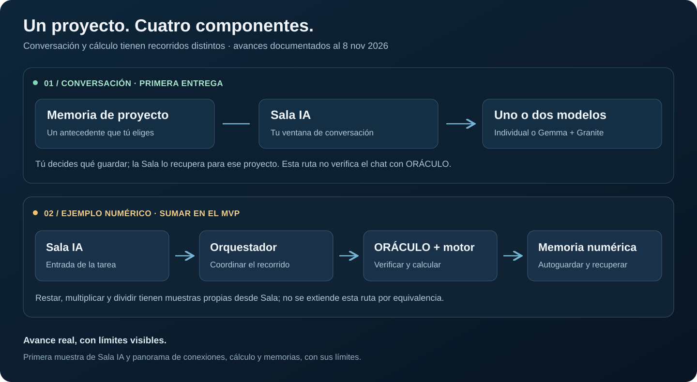

# Conexión de Sala IA con el Orquestador y ORÁCULO

[Volver a NÉMESIS](https://github.com/jesco009-afk/nemesis-sala-ia).

En el recorrido numérico de NÉMESIS, una tarea pasa por varias piezas antes de convertirse en un resultado guardado. La Sala recibe el encargo, el Orquestador coordina a los modelos y ORÁCULO revisa la propuesta bajo unas reglas concretas. El motor calcula después, con un recibo separado.

## Un ejemplo que ya recorrió las piezas

El **6 de noviembre de 2026**, una sesión nueva de **Sala numérica AUTO**, con Ollama **0.40.15**, completó el encargo de implementar SUMAR y comprobarla con **23 y 16**. El motor registró **39 como número entero** y el flujo guardó un resultado nuevo.

**Sala numérica → Orquestador → Adaptador → ORÁCULO → Motor → Memoria**

| Pieza | Qué hizo en este ejemplo |
| --- | --- |
| **Sala numérica AUTO** | Recibió la tarea y recuperó un antecedente identificado como histórico, separado del resultado actual. |
| **Orquestador** | Coordinó a Qwen para proponer el código y a Gemma para revisarlo. Ambas respuestas se completaron con HTTP 200. |
| **Adaptador** | Enlazó la propuesta con sus reglas, la tarea y la sesión para que los recibos correspondieran al mismo trabajo. |
| **ORÁCULO** | Aceptó la estructura del candidato mediante una revisión estática condicionada al contrato de suma, sin ejecutar el código. |
| **Motor de cálculo** | Registró por separado un cálculo nuevo: **23 + 16 = 39**, de tipo entero. |
| **Memoria numérica** | Conservó el resultado nuevo. Las lecturas posteriores recuperaron registros sin volver a calcular. |

Participaron **Qwen 3 4B Instruct** (`qwen3:4b-instruct-2507-q4_K_M`) y **Gemma 4 E2B IT-QAT** (`gemma4:e2b-it-qat`). Son los modelos de este recorrido numérico; el modo doble conversacional utiliza Gemma y Granite.

## Verificar, calcular y recordar tienen funciones distintas

ORÁCULO revisó el candidato bajo un contrato limitado de suma. Su aceptación estática no era todavía el resultado del cálculo. La procedencia se enlazó mediante el adaptador y los recibos; la API de ORÁCULO no la certificó por sí sola.

El motor produjo el resultado nuevo y la memoria lo conservó. Recuperar el 39 anterior no sustituyó el recálculo. El ensayo registró **dos respuestas generativas, un cálculo y cero reintentos registrados**.

## Qué alcanza esta conexión

El ejemplo demuestra el recorrido numérico descrito. **El chat gráfico de conversación libre es otra ruta:** sus respuestas no pasan automáticamente por ORÁCULO o por el motor.

Los modelos pueden equivocarse. Este caso no demuestra corrección de cualquier programa, todos los operandos, concurrencia o un rendimiento garantizado en otros equipos. La recuperación numérica por identidad tampoco equivale a búsqueda semántica general.

El cierre y el dictamen final de **INF-000352 / REG-000631** respaldan este caso histórico. Los expedientes originales permanecen bajo custodia del proyecto. Esta entrega lo explica sin repetir la ejecución.

[Evidencia y alcance](https://github.com/jesco009-afk/nemesis-sala-ia/blob/main/docs/evidencia-y-alcance.md) · [Conversación y memorias](https://github.com/jesco009-afk/nemesis-sala-ia/blob/main/docs/recorridos-y-memoria.md) · [Avances y pendientes](https://github.com/jesco009-afk/nemesis-sala-ia/blob/main/docs/avance-y-pendientes.md).
