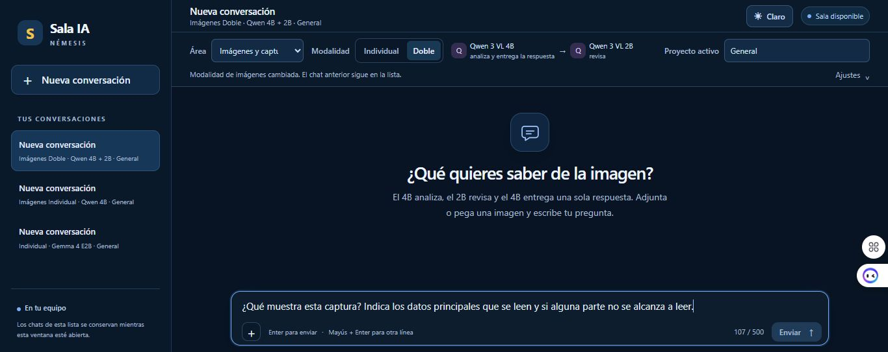

# Modalidades y modelos de Sala IA

© 2026 **Jean y equipo NÉMESIS** · [CC BY 4.0](../LICENSE.txt)

La Sala local incluye áreas de conversación, programación, análisis de imágenes, documentos y razonamiento. El catálogo corresponde a la configuración R016. Cada área usa modelos y funciones propios.

| Área | Individual | Doble |
| --- | --- | --- |
| **Conversación** | Se elige uno entre Gemma 4 E2B, Granite 3.3 8B, Qwen 3.5 4B y Gemma 3 4B. | Gemma 4 E2B redacta y Granite 3.3 8B revisa. Gemma ajusta la respuesta si la revisión pide cambios. |
| **Programación** | Qwen 2.5 Coder 3B propone código. | Qwen 2.5 Coder 3B propone y CodeGemma 7B revisa. |
| **Imágenes y capturas** | Qwen 3 VL 4B analiza la imagen adjunta. | Qwen 3 VL 4B analiza, Qwen 3 VL 2B revisa y Qwen 3 VL 4B responde. |
| **Documentos** | EmbeddingGemma 300M Q4 busca fragmentos en el corpus piloto. | EmbeddingGemma 300M Q4 y Q8 aportan resultados a la búsqueda. |
| **Razonamiento** | Phi-4 14B analiza el problema. | Phi-4 14B analiza y Phi-4 Mini 3.8B aporta una segunda opinión sobre la ficha inicial. |

*Captura de Sala IA R011 antes de enviar una consulta. Se ven el área Imágenes y capturas, el modo Doble y los roles de Qwen 3 VL 4B y 2B.*

## Alcance comprobado

- **Conversación.** C05 documenta una respuesta individual en R001 y un recorrido doble en R002. La respuesta del modo doble omitió parte de la comparación solicitada. INF-000383.
- **Programación.** PRG08 cubrió en R006 una tarea fija de práctica con siete casos aprobados en cada modalidad. El usuario revisó, aplicó y restauró el cambio de práctica. Las tareas libres requieren validación externa. INF-000398 y activación posterior de R007 en INF-000399.
- **Imágenes y capturas.** VIS11 probó en R011 ambas modalidades con una imagen adjunta. Los dos modos se equivocaron al describir el color de unas fotos. Esta área analiza imágenes que aporta el usuario. INF-000400.
- **Documentos.** D07 probó en R015 un corpus piloto de siete documentos. Tres de cuatro casos cumplieron el resultado esperado. El modo doble omitió evidencia presente en el caso restante. INF-000405.
- **Razonamiento.** R06 aceptó la prueba supervisada con Phi-4 14B. R016 incorpora el modo doble. R07 documenta la activación de la Sala local. La aceptación de R06 corresponde al modo individual.

La documentación describe la implementación local y sus pruebas. El paquete instalable de Windows sigue pendiente de preparación y validación.

[Volver a la portada](../README.md) · [Evidencia y alcance](evidencia-y-alcance.md)
